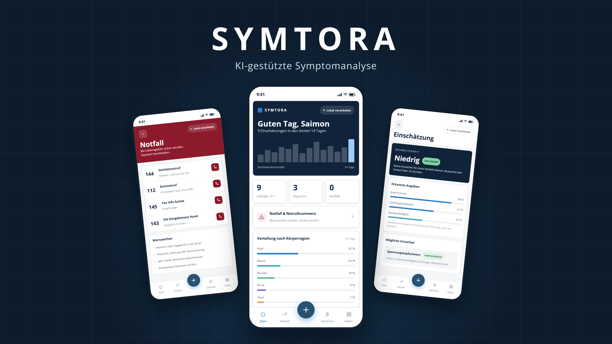
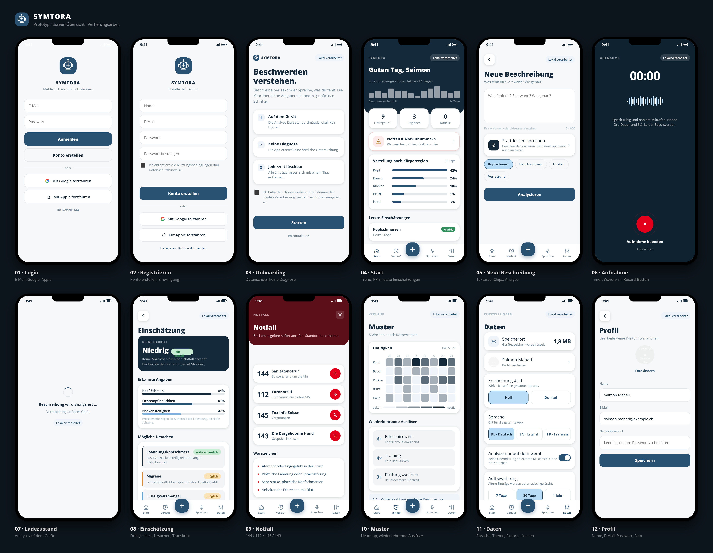
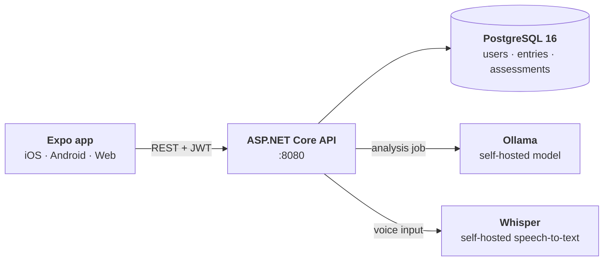

<div align="center">



<br>

**Describe what's wrong. Get an urgency level, possible causes and concrete next steps.**

A symptom-triage app built as a Swiss *Vertiefungsarbeit* (capstone): an Expo client,
a .NET API, and a self-hosted language model that never sends health text to a
third party.

<br>

[](#project-status)
[](src/frontend/app.json)
[](https://docs.expo.dev/versions/v57.0.0/)
[](https://reactnative.dev)
[](https://dotnet.microsoft.com)
[](https://www.postgresql.org)
[](https://ollama.com)
[](src/frontend/src/i18n)
[](LICENSE)

</div>

> [!WARNING]
> **Symtora is not a medical device and gives no diagnosis.** It is a student project.
> In an emergency in Switzerland, call **144**.

> [!TIP]
> **Just want to try it?** Install Docker Desktop, download the code and double-click
> `Start Symtora` — the step-by-step guide for Windows and macOS walks you through it:
> **[English](docs/run-guide.en.md)** · **[Deutsch](docs/run-guide.de.md)**

---

## What it is

You describe a complaint in your own words — by text, or by voice. The app
sorts that description into an **urgency level**, a list of **detected findings**,
**possible causes** with a confidence label, and **concrete next steps**. Over time it
builds a picture of your history: a 14-day intensity trend, a breakdown by body region,
and recurring triggers.

Three promises are shown at onboarding and carried through the whole app:

| Promise | What it means here |
|---|---|
| **Processing stays under your control** | Analysis runs on a self-hosted model (Ollama), not a third-party AI API. Symptom text never leaves infrastructure you run. |
| **No medical diagnosis** | Every result screen carries a disclaimer; urgency is a triage hint, not a finding. |
| **Deletable at any time** | `DELETE /me/data` wipes every entry and assessment for the account in one tap. |

The Swiss context is throughout: emergency numbers 144 / 112 / 145 (Tox Info Suisse) /
143, and the three national languages.

## Screens



## Project status

This is a working prototype, not a finished product. Being precise about what is real:

| Area | State |
|---|---|
| Screens, navigation, theming, i18n | **Done** — all 12 screens, DE/EN/FR, light/dark, switchable at runtime |
| Sign-in & registration | **Live against the API** — the session and your settings survive a restart |
| Entries & assessments | **Live against the API** — new entries are analysed by the self-hosted model and the result screen renders the stored assessment |
| Patterns heatmap, triggers, home KPIs | **Demo data** from `src/frontend/src/data/cases.ts` |
| Backend analysis pipeline | **Built** — `POST /entries` enqueues a job, a worker runs it through Ollama, `GET /entries/:id` is polled until it is `Done` |
| Google / Apple sign-in | **Placeholders** — the buttons render, the API has password auth only |
| Voice transcription | **Works everywhere** — development builds recognise on-device (offline); Expo Go and web record and transcribe on the self-hosted Whisper container. The transcript lands in the text box for review |

## Architecture



Two decisions shape the rest:

- **A self-hosted model, not a hosted AI API.** Symptom text is health data; routing it
  through a third party would contradict the promise the onboarding makes.
- **`POST /entries` is asynchronous.** It returns `202` immediately and the client polls,
  because local-model inference can take a while and a long synchronous call is fragile on
  a mobile network.

## Getting started

> [!TIP]
> Not a developer? The [step-by-step run guide](docs/run-guide.en.md)
> ([Deutsch](docs/run-guide.de.md)) needs only Docker Desktop: `Start Symtora.bat` /
> `Start Symtora.command` creates `.env` with a fresh `JWT_SECRET`, starts the whole stack including
> the Expo dev server, and prints the Expo Go QR code. The options below are the developer version.

### Option A — the whole stack, with Docker

Brings up the API, Postgres, Ollama, and a one-shot job that pulls the model weights before
the API starts serving.

```bash
git clone https://github.com/smadev10/symtora.git
cd symtora
cp .env.example .env         # then set JWT_SECRET — e.g. openssl rand -base64 48
docker compose up --build
```

The API is then on **`http://localhost:8080`**. The first run downloads the model
(multi-GB); later runs reuse the `ollama_models` volume.

This also starts the `app` service: the Expo dev server in a container, on
**`http://localhost:8081`** for the browser. For Expo Go on a phone it needs `LAN_IP` in `.env`
(the start scripts fill it in), otherwise Metro hands out the container's address.

To work on the frontend with live reload instead, bring up only the backend so port 8081 stays
free, and start the app on your machine:

```bash
docker compose up --build api   # api and what it depends on, without `app`
```

```bash
cd src/frontend
npm install
npm start                    # press a / i / w, or scan the QR in Expo Go
```

> [!NOTE]
> Voice input works in Expo Go: the app records and the API transcribes on the `whisper`
> container (`docker compose up` starts it; the first transcription downloads the model).
> A development build (`npx expo run:android` / `run:ios`) uses on-device recognition instead,
> which needs the phone's offline speech model for the app language.

### Option B — local dev loop, without Docker

Faster to iterate on. Needs Postgres and Ollama reachable on `localhost` (see
`src/backend/src/Symtora.Api/appsettings.Development.json`).

```bash
cd src/backend
dotnet tool restore                                   # installs dotnet-ef locally, once
dotnet ef database update --project src/Symtora.Api   # applies migrations
dotnet run --project src/Symtora.Api
```

> [!IMPORTANT]
> Run this way the API listens on **`5014`**, not `8080` — set `EXPO_PUBLIC_API_URL` in
> `src/frontend/.env` accordingly (see below).

In Development you also get the browsable API reference (Scalar) at
**`http://localhost:5014/scalar`**, and the raw OpenAPI document at `/openapi/v1.json`.
Log in via `POST /auth/login`, paste the returned token into the reference's *Authorize*
field, and every `[Authorize]` endpoint is runnable straight from the page. In the
container both are off unless you set `EXPOSE_API_DOCS=true` in `.env`.

### Pointing the app at the API

Nothing to configure for the usual setup: the app calls the API on the machine it was loaded
from, on port `8080`. Expo Go on a phone, the web build and the simulators find it on their own,
also after the PC moves to another Wi-Fi. Device and PC must be on the same network.

To point the app elsewhere, copy `.env.example` to `.env` and set `EXPO_PUBLIC_API_URL`, then
restart with `npx expo start -c` (the value is inlined into the bundle, so nothing secret
belongs in it):

| When | `EXPO_PUBLIC_API_URL` |
|---|---|
| Option B (`dotnet run`) | `http://<your-lan-ip>:5014` |
| Android emulator, if auto-detection fails | `http://10.0.2.2:8080` |

### Everyday commands

```bash
# frontend — from src/frontend
npm start            # expo start
npm run android      # or: ios, web
npm test             # jest (jest-expo + @testing-library/react-native)
npm run typecheck    # tsc --noEmit

# backend — from src/backend
dotnet test
```

## Project layout

Everything at the root is project-level; all code sits under `src/`.

| Path | Purpose |
|---|---|
| `docker-compose.yml` | The whole stack: API, Postgres, Ollama, model-pull job, Whisper, Expo dev server |
| `.env.example` | Compose configuration — copy to `.env` |
| `Start Symtora.*`, `Stop Symtora.*` | Double-click launchers (`.bat` Windows, `.command` macOS) for the run guide |
| `scripts/` | What the launchers run: `start.ps1` (Windows), `start.sh` (macOS) |
| `docs/` | Design spec, README images, and the app-icon generator |
| `src/backend/` | The .NET API — has its own [README](src/backend/README.md) |
| `src/frontend/` | The Expo app |

<details>
<summary><b>Inside <code>src/frontend/</code></b></summary>

| Path | Purpose |
|---|---|
| `src/app/` | expo-router routes — one file per screen (entry point is `expo-router/entry`) |
| `src/app/_layout.tsx` | Providers, font loading, and the gate that waits for storage before routing |
| `src/app/(tabs)/` | The screens that show the bottom nav |
| `src/api/` | `request()` client, the `ApiError` union, DTOs mirroring the backend, auth calls |
| `src/state/` | `session`, `settings` and `entries` — a pure reducer plus a provider each |
| `src/storage/` | `KeyValueStore` over AsyncStorage and SecureStore |
| `src/repositories/` | `EntriesRepository` — the seam the API slots into; demo implementation today |
| `src/theme/` | Colour tokens, shared styles, per-theme style caching |
| `src/i18n/` | `de` / `en` / `fr`; German defines the type every language must satisfy |
| `src/components/` | `AppText`, icons, animations, buttons, shared loading/empty/error/offline states |
| `src/data/cases.ts` | Demo assessments (`CASES`) and chart constants (`HEAT`, `DIST`, `TREND`) |
| `assets/` | App icon, splash, adaptive-icon layers, favicon |

Routes that show the bottom nav live in `(tabs)`; `emergency` and `assessment/[id]` sit in
that group with `href: null`, so the bar stays visible without them being tabs. There is no
`loading` route — analysing is a state of the screen that triggers it, not a destination you
can navigate back into.

</details>

<details>
<summary><b>Inside <code>src/backend/</code></b></summary>

| Path | Purpose |
|---|---|
| `src/Symtora.Api/Models/` | EF Core entities: `User`, `SymptomEntry`, `Assessment` |
| `src/Symtora.Api/Data/` | `SymtoraDbContext` and EF Core migrations |
| `src/Symtora.Api/Services/Auth/` | Password hashing, JWT issuance, register/login logic |
| `src/Symtora.Api/Services/Analysis/` | Prompt building, Ollama client, response parsing, the background job queue + worker |
| `src/Symtora.Api/Controllers/` | `AuthController`, `EntriesController`, `PatternsController`, `MeController` |
| `tests/Symtora.Api.Tests/` | Unit tests |

</details>

## API

| Endpoint | Auth | Notes |
|---|---|---|
| `POST /auth/register` | – | `{ email, password }` → `{ token, expiresAt }` |
| `POST /auth/login` | – | same shape |
| `POST /entries` | Bearer | `{ text, bodyRegion? }` → `202` + `{ id, status: "Pending" }` |
| `GET /entries/:id` | Bearer | Poll until `status` is `"Done"` or `"Failed"` |
| `GET /entries` | Bearer | Full history for the current user, newest first |
| `GET /patterns` | Bearer | Body-region breakdown (count, last urgency, last seen) |
| `DELETE /me/data` | Bearer | Deletes the user's entries and assessments, keeps the account |
| `POST /transcriptions` | Bearer | multipart `audio` → `{ text }`; audio is not stored |
| `GET /health` | – | Liveness check |

Full detail in [`src/backend/README.md`](src/backend/README.md).

## Stack

**App** — Expo SDK 57, React Native 0.86, React 19, TypeScript. expo-router for file-based
routing (with web URLs and `symtora://` deep links), AsyncStorage for settings and
expo-secure-store for the session token, `@expo-google-fonts/open-sans`, and
react-native-svg for every icon and the logo — there is no icon font or image set.
jest-expo and `@testing-library/react-native` for tests.

**API** — ASP.NET Core on .NET 10, EF Core with Npgsql against PostgreSQL 16, JWT bearer
auth, Scalar for the browsable reference, and a hosted `BackgroundService` draining an
in-process analysis queue against Ollama. REST only — a fixed, small set of endpoints
doesn't need GraphQL or gRPC.

## Brand assets

The mark is the `LogoMark` in
[`src/frontend/src/components/icons.tsx`](src/frontend/src/components/icons.tsx) — the
same geometry as [`docs/images/logo.svg`](docs/images/logo.svg). The app icon, adaptive
Android layers, splash icon and favicon are rasterised from it by
[`docs/make-icons.js`](docs/make-icons.js):

```bash
node docs/make-icons.js src/frontend/assets
```

## License

[MIT](LICENSE).
